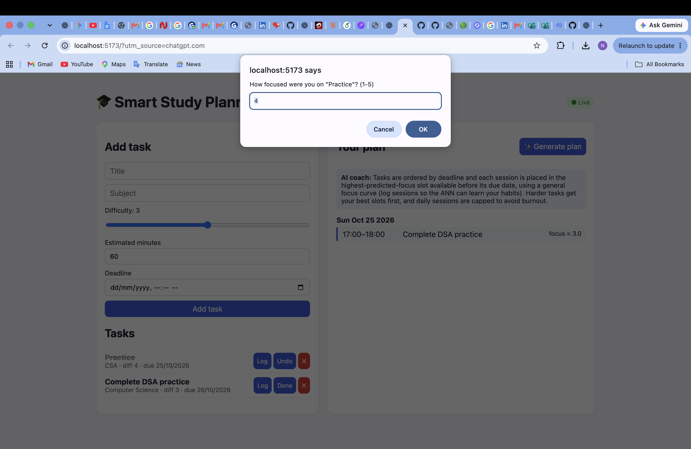
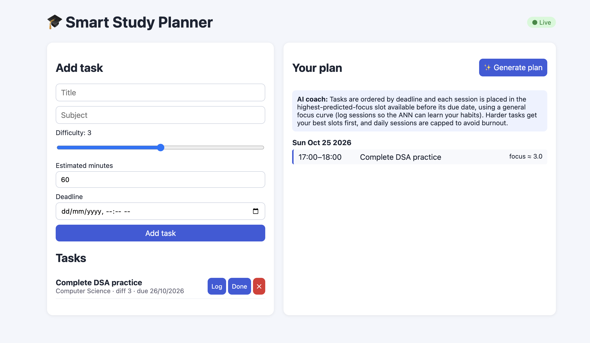

# 🧠 Smart Study Planner

**An AI-powered web application for intelligent study planning and task scheduling.**

Smart Study Planner is a full-stack application designed to help students organize academic tasks and generate structured study plans. It combines a React frontend, a Node.js backend, MongoDB for data persistence, and a Python-based machine learning service.

The goal is to make study planning more organized, manageable, and adaptable to students' academic priorities.

## ✨ Features

- **Task Management:** Add academic tasks with details such as subject, difficulty, estimated duration, and deadline.
- **Automated Study Planning:** Generate a structured study plan based on the tasks entered.
- **Interactive Dashboard:** Manage tasks and view the generated plan through a web-based interface.
- **Full-Stack Architecture:** Separate frontend, backend, and machine learning service.
- **REST API:** Backend API for application functionality.
- **WebSocket Support:** Backend includes WebSocket functionality for real-time communication.
- **Database Integration:** MongoDB integration for storing application data.
- **Modular Design:** Separate services make the project easier to maintain and extend.

## 🖥️ Application Preview

<!-- Add your screenshot to the repository's screenshots/ folder, then uncomment the next line. -->
<!--  -->

## 📸 Application Screenshots

### Smart Study Planner Dashboard



### Generated Study Plan




## 🛠️ Technology Stack

| Component | Technologies |
|---|---|
| Frontend | React.js, Vite, JavaScript, CSS |
| Backend | Node.js, Express.js |
| Database | MongoDB, Mongoose |
| Machine Learning Service | Python, FastAPI |
| Communication | REST APIs, WebSockets |
| Development Tools | Git, GitHub, npm |

## 🏗️ Project Architecture

```text
Smart-Study-Planner/
├── client/                 # React + Vite frontend
├── server/                 # Node.js + Express backend
│   └── src/
│       ├── models/          # MongoDB models
│       ├── routes/          # API routes
│       └── services/        # Scheduling, ML and LLM services
├── ml-service/              # Python FastAPI service
├── docker-compose.yml       # Container orchestration configuration
└── README.md
```

### How It Works

1. The student enters academic tasks through the React interface.
2. The frontend communicates with the backend through API requests.
3. The backend processes task information and coordinates the planning workflow.
4. The application generates a study plan for the student to review.
5. MongoDB provides database storage for supported application data.

The machine learning service is separated from the main backend to support modular development and future enhancements.

## ⚙️ Prerequisites

Install the following before running the application:

- [Node.js and npm](https://nodejs.org/)
- [MongoDB Community Server](https://www.mongodb.com/try/download/community)
- [Python 3](https://www.python.org/downloads/)
- Git

## 🚀 Getting Started

### 1. Clone the repository

```bash
git clone https://github.com/nitishkumar1710/Smart-Study-Planner.git
cd Smart-Study-Planner
```

### 2. Configure the backend

```bash
cd server
npm install
cp .env.example .env
```

Update `server/.env` with your local configuration:

```env
PORT=5001
MONGO_URI=mongodb://127.0.0.1:27017/study-planner
ML_URL=http://127.0.0.1:8000

ANTHROPIC_API_KEY=
LLM_MODEL=claude-sonnet-4-6

DAY_START=7
DAY_END=23
MAX_SESSIONS_PER_DAY=4
```

Keep API keys and other secrets private. Never commit your actual `.env` file.

### 3. Start MongoDB

On macOS with Homebrew:

```bash
brew services start mongodb-community@7.0
```

Make sure MongoDB is running before starting the backend.

### 4. Start the backend

From the `server` directory:

```bash
npm run dev
```

The backend runs on port `5001` with the current local configuration.

Keep this terminal running.

### 5. Start the frontend

Open another terminal window:

```bash
cd client
npm install
npm run dev
```

Open the local URL printed by Vite, normally:

http://localhost:5173

### 6. Start the machine learning service

The project includes a Python FastAPI service in `ml-service/`. Install its dependencies:

```bash
cd ml-service
python3 -m venv .venv
source .venv/bin/activate
pip install -r requirements.txt
```

Start the service using the entry point and command supported by `ml-service/app.py` and its dependencies. Confirm that the service is available at the configured `ML_URL`.

## 📁 Main Components

### Frontend — `client/`

Provides the user interface for entering study tasks and viewing the generated plan.

### Backend — `server/`

Handles application requests, database models, task scheduling, and communication with supporting services.

### Machine Learning Service — `ml-service/`

Provides a separate Python-based service intended for machine learning functionality.

## 🔐 Configuration and Security

- Store credentials and API keys in local environment variables.
- Keep `.env` files out of version control.
- Use `.env.example` to document the required configuration variables.
- Do not publish database credentials, tokens, or private keys.

## 🔮 Future Enhancements

- Personalized recommendations based on study habits and completion history.
- Progress tracking and study analytics.
- Calendar integration and deadline reminders.
- Adaptive scheduling based on task completion.
- Improved responsive design and accessibility.
- Automated testing and deployment.

## 🎯 Project Objective

The project explores how full-stack web development, data persistence, scheduling logic, and machine learning services can be combined to build a practical academic productivity application.

## 👨‍💻 Author

**Nitish Kumar**

B.Tech — Computer Science Engineering (Data Science)  
Manipal University Jaipur

- GitHub: [nitishkumar1710](https://github.com/nitishkumar1710)
- LinkedIn: [Nitish Kumar](https://linkedin.com/in/nitishkumar0707)

---

*Built as a project exploring AI-assisted academic planning and full-stack application development.*
